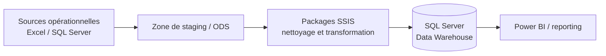
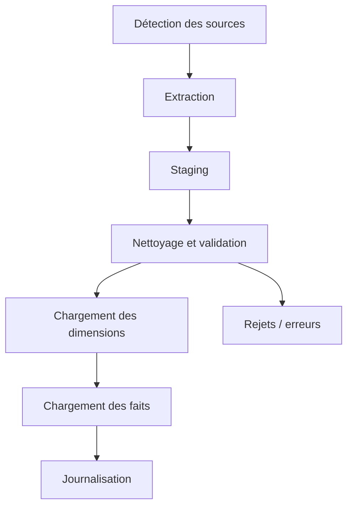

# Data Warehouse & SSIS

Documentation du projet d'alimentation du Data Warehouse avec SQL Server
Integration Services (SSIS).

## Présentation

Ce projet met en place un flux ETL permettant d'extraire les données des
sources opérationnelles, de les contrôler et de les transformer avant leur
chargement dans un Data Warehouse SQL Server.

Le Data Warehouse centralise les données nécessaires au suivi des placements,
des objectifs, des structures, des produits, des devises et des maturités. Les
données peuvent ensuite être exploitées par Power BI et par les services
analytiques de la plateforme BNA.

## Objectifs

- Centraliser les données dans un modèle décisionnel cohérent.
- Automatiser l'extraction et le chargement des données.
- Nettoyer et standardiser les données avant leur exploitation.
- Détecter les doublons, les valeurs manquantes et les formats invalides.
- Alimenter les tableaux de bord et les indicateurs métier.
- Faciliter la maintenance et le suivi des traitements ETL.

## Architecture des données

### Cible

La cible est une base SQL Server organisée selon un modèle dimensionnel :

- les tables de faits contiennent les mesures et les événements métier 
- les tables de dimensions décrivent les axes d'analyse 
- les clés et les règles d'intégrité assurent la cohérence des données.

## Flux ETL SSIS

Le flux général est le suivant :

1. Déposer ou sélectionner les fichiers sources.
2. Vérifier la présence, le nom et le format des fichiers.
3. Extraire les données avec les composants SSIS.
4. Charger les données brutes dans la zone de staging.
5. Nettoyer et convertir les types, dates, montants et devises.
6. Contrôler les doublons et les valeurs invalides.
7. Charger les dimensions.
8. Charger les tables de faits.
9. Journaliser le résultat de l'exécution et les éventuelles erreurs.

## Modèle du Data Warehouse

| Table | Type | Description |
| --- | --- | --- |
| `DW.FAIT_PLACEMENT` | Fait | Mesures et informations des placements |
| `DW.FAIT_OBJECTIF` | Fait | Objectifs par structure et par période |
| `DW.DIM_TEMPS` | Dimension | Dates de souscription, d'échéance et calendrier |
| `DW.DIM_STRUCTURE` | Dimension | Agences et directions |
| `DW.DIM_MATURITE` | Dimension | Catégories de maturité |
| `DW.DIM_PRODUIT` | Dimension | Produits financiers |
| `DW.DIM_DEVISE` | Dimension | Devises utilisées |
| `DW.DIM_ACTIVITE` | Dimension | Activités économiques |

## Captures d'écran

### Vue d'ensemble du projet SSIS

  

### Flux de données

  

  

## Installation et configuration

1. Installer SQL Server et SQL Server Integration Services.
2. Installer Visual Studio avec l'extension SQL Server Data Tools (SSDT).
3. Restaurer ou créer les bases source, staging et Data Warehouse.
4. Configurer les gestionnaires de connexions SSIS pour l'environnement cible.
5. Renseigner les paramètres sans les committer dans le dépôt.
6. Exécuter d'abord les packages dans un environnement de test.
7. Vérifier les logs, les rejets et les volumes chargés.

Les scripts SQL, les fichiers de configuration et les paramètres propres à
l'environnement doivent être documentés séparément s'ils contiennent des
informations sensibles.

## Limites et améliorations

- `<Limite actuelle du chargement>`
- `<Contrôle qualité à ajouter>`
- `<Optimisation de performance>`
- `<Amélioration de la supervision>`

## Références

- [README général du projet](https://github.com/Achref-004/BNA-Platform/blob/main/README.md)

